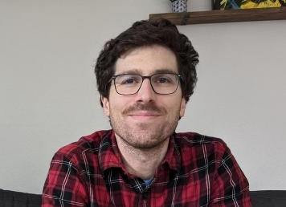

::: {.grid}

<!-- Person 1 -->
::: {.g-col-12 .g-col-md-6 .g-col-lg-4}
::: {.card .h-100 .shadow-sm}
{.card-img-top style="height: 220px; object-fit: cover;"}

::: {.card-body .d-flex .flex-column}
#### Person 1 {.card-title .mb-1}
*Bioinformatics Specialist* {.card-subtitle .text-muted .mb-3}

::: {.card-text}
Focuses on environmental DNA (eDNA) monitoring and high-throughput sequencing pipelines.
:::

::: {.d-flex .flex-wrap .gap-1 .mt-auto .pt-3}
<a href="https://github.com/janedoe" target="_blank" class="btn btn-outline-dark btn-sm"><i class="bi bi-github"></i> GitHub</a>
<a href="https://scholar.google.com/citations?user=SCHOLAR_ID" target="_blank" class="btn btn-outline-primary btn-sm"><i class="bi bi-mortarboard-fill"></i> Scholar</a>
<a href="mailto:jane.doe@noaa.gov" class="btn btn-outline-secondary btn-sm"><i class="bi bi-envelope-fill"></i> Email</a>
:::
:::
:::
:::

<!-- Reid Brennan -->
::: {.g-col-12 .g-col-md-6 .g-col-lg-4}
::: {.card .h-100 .shadow-sm}
{.card-img-top style="height: 220px; object-fit: cover;"}

::: {.card-body .d-flex .flex-column}
#### Reid Brennan {.card-title .mb-1}
*Research Biologist*

::: {.card-text}
Population genomics, epigenomics, transcriptomics, adaptation, evolution; Works on marine mammals and fishes.
:::

::: {.d-flex .flex-wrap .gap-1 .mt-auto .pt-3}
<a href="https://github.com/rsbrennan-NOAA" target="_blank" class="btn btn-outline-dark btn-sm"><i class="bi bi-github"></i> GitHub</a>
<a href="https://scholar.google.com/citations?user=4Ykg3a0AAAAJ&hl=en" target="_blank" class="btn btn-outline-primary btn-sm"><i class="bi bi-mortarboard-fill"></i> Scholar</a>
<a href="https://orcid.org/0000-0001-7678-564X" target="_blank" class="btn btn-outline-success btn-sm"><i class="bi bi-person-badge"></i> ORCID</a>
<a href="mailto:reid.brennan@noaa.gov" class="btn btn-outline-secondary btn-sm"><i class="bi bi-envelope-fill"></i> Email</a>
:::
:::
:::
:::

:::
